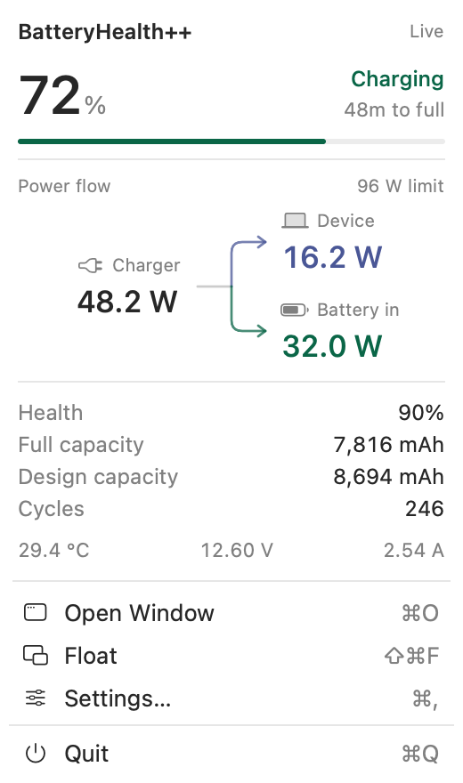
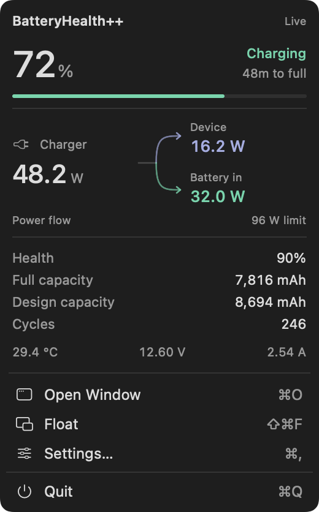

# BatteryHealth++

A quiet, native battery and power monitor for **Apple Silicon Macs running macOS 14+**. SwiftUI, IOKit, and a small read-only AppleSMC client. No third-party packages, accounts, network requests, root helper, or charging-control writes.

| Light | Dark |
| --- | --- |
|  |  |

## What’s included

- A native macOS status menu with a compact live readout and standard menu commands. Opening it does not activate the app or create a key window.
- A compact battery icon with the percentage inside; charging adds a small bolt. Desktop Macs show system wattage.
- The menu opens on launch; there is no automatic overview window or Dock icon.
- Explicit **Open Window** and **Float** actions for the detailed overview and draggable floating readout.
- Light and dark appearances that follow macOS, including the dropdown, windows, and floating panel.
- Battery health, current charge, full-charge and original capacity in mAh, cycle count, temperature, and estimated charging / battery time when available.
- Direct SMC charger input and device load, with an estimated battery split. Registry telemetry is the fallback. Advertised charger wattage is labeled separately as the connection’s capability.
- A ten-minute in-memory power chart. History begins when the app opens; no invented points or persisted usage log.
- Automatic power-only presentation on desktop Macs, using the AppleSMC `PSTR` sensor when available.
- Optional launch at login, enabled explicitly in Settings.

The images above preview the readout; Open Window, Float, Settings, and Quit are native macOS menu items beneath it. The images in `Docs/Previews` use **design fixtures**, not this Mac’s measurements. Live views always use hardware data. `--render-previews` is the only runtime entry point for design fixtures.

## Build and run

Clone the source:

```sh
git clone https://github.com/mxudev/BatteryHealthPlus.git
cd BatteryHealthPlus
```

Open `BatteryHealthPlus.xcodeproj`, select **BatteryHealthPlus**, and run on **My Mac**. The app builds only `arm64`. Xcode 15+ is required; the project was built and checked with Xcode 27.2 on an Apple Silicon MacBook Pro.

For a local ad-hoc signed build:

```sh
./Scripts/build.sh --run
```

The app is generated at:

```text
build/DerivedData/Build/Products/Release/BatteryHealth++.app
```

Keep the app running for live sampling. Click the menu bar battery to open or dismiss the dropdown; Escape or clicking outside dismisses it. Choose **Open Window** (⌘O) for the overview or **Float** (⇧⌘F) for the floating panel. Its upper-right close button hides it. **Settings…** (⌘,) includes launch at login. Closing a window (⌘W) leaves the menu bar app running; **Quit** (⌘Q) stops it. Relaunching opens only the dropdown, even if a window was open when the app quit.

For a stable installation, copy the built app into Applications and launch it there.

For distribution, select your signing team and choose a unique bundle identifier. No App Group is required. Developer ID signing and notarization are not configured; the supplied script produces a **local development build**. Private sensor access is intended for direct distribution and should not be assumed to satisfy Mac App Store review requirements.

## Honest measurements

| Reading | Meaning |
| --- | --- |
| Health | Full-charge capacity ÷ design capacity; can differ from System Settings’ estimate. The numerical percentage retains values over 100%. |
| From charger | Measured DC power entering the Mac, not the adapter’s maximum rating or wall-socket consumption. |
| Mac | Direct SMC system power (`PSTR`), with registry system-load telemetry as fallback. |
| Battery in / out | Estimated from direct charger input (`PDTR`) minus device power (`PSTR`); otherwise registry battery telemetry. Positive charges the battery; negative supplies the Mac. |
| Calculated readings | Shown without a symbol; “Readings & sources” explains the calculation. Subtraction estimates can include conversion losses and sensor timing differences. |
| — | Unavailable. Missing sensor data is never fabricated. |

Direct SMC power is sampled approximately every second while a live view is visible. It bypasses the slower battery registry cache; health, capacity, current, and time estimates still come from the registry. A complete direct power pair is never delayed waiting for that cache. Independent sensors can sample at different times; estimated battery power within ±0.5 W is treated as idle to avoid flickering direction near zero. This app does not measure a wall socket.

## Verify and inspect

```sh
swift test
swift run power-probe
swift run power-probe --smc
```

The probe prints selected readings and their provenance, without battery serial numbers. `PSTR` and `PDTR` are the primary power sources. `--smc` additionally prints individual key readings, including the exploratory `PPBR` key, which is not used for the app’s battery power calculation.

To check the signed app’s sensors:

```sh
'build/DerivedData/Build/Products/Release/BatteryHealth++.app/Contents/MacOS/BatteryHealth++' --diagnose
```

To regenerate the design previews:

```sh
'build/DerivedData/Build/Products/Release/BatteryHealth++.app/Contents/MacOS/BatteryHealth++' --render-previews "$PWD/Docs/Previews"
```

The unit suite covers modern nested battery properties, legacy signed currents, battery discharge and assistance, missing fields, valid idle zeros, invalid measurements, SMC decoding, desktop adaptation, and snapshot serialization.

`Scripts/generate-project.py` generates the checked-in Xcode project without XcodeGen. Run it after adding source files. It also regenerates the plist and entitlement templates, so preserve any custom signing changes in that script. `Scripts/make-icon.swift` regenerates the original native app icon.

See [API research and limitations](Docs/API-Research.md) for field mappings, source links, and the tested hardware scope.

## Contributing and license

See [CONTRIBUTING.md](CONTRIBUTING.md) for development and hardware-reporting guidance. Released under the [MIT license](LICENSE).
