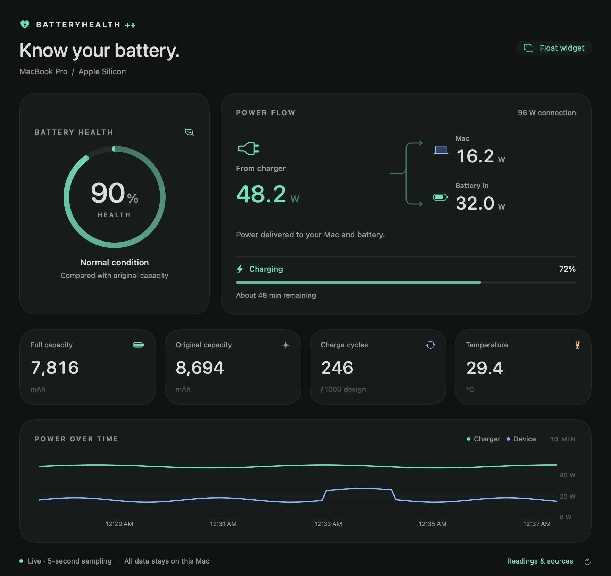

# BatteryHealth++

A quiet, native battery and power monitor for **Apple Silicon Macs running macOS 14+**. SwiftUI, WidgetKit, IOKit, and a small read-only AppleSMC client. No third-party packages, accounts, network requests, root helper, or charging-control writes.



## What’s included

- Small, medium, and large desktop / Notification Center widgets.
- A draggable floating widget and menu bar panel, sampled every five seconds while awake.
- Battery health, current charge, full-charge and original capacity in mAh, cycle count, temperature, and estimated charging / battery time when available.
- Actual charger input, device load, and signed battery power. Advertised charger wattage is labeled separately as the connection’s capability.
- A ten-minute in-memory power chart. History begins when the app opens; no invented points or persisted usage log.
- Automatic power-only presentation on desktop Macs, using the AppleSMC `PSTR` sensor when available.
- Optional launch at login, enabled explicitly in Settings.

The images in `Docs/Previews` use **design fixtures**, not this Mac’s measurements. Live views always use hardware data. `--render-previews` is the only runtime entry point for design fixtures outside WidgetKit’s gallery placeholders.

## Build and run

Clone the source:

```sh
git clone https://github.com/mxudev/BatteryHealthPlus.git
cd BatteryHealthPlus
```

Open `BatteryHealthPlus.xcodeproj`, select **BatteryHealthPlus**, and run on **My Mac**. Both targets build only `arm64`. Xcode 15+ is required; the project was built and checked with Xcode 27.2 on an Apple Silicon MacBook Pro.

For a local ad-hoc signed build:

```sh
./Scripts/build.sh --run
```

The app is generated at:

```text
build/DerivedData/Build/Products/Release/BatteryHealth++.app
```

Keep the app running for live sampling. Desktop widgets sample independently, even when the app is closed. Closing the overview leaves the menu bar app running; Quit stops it. Use **Float widget** to show the draggable panel. Hover its upper-right corner for the close button, or reopen it from the menu bar / Window menu.

For a stable installation, copy the built app into Applications and launch it there. Right-click the desktop → **Edit Widgets** → search **BatteryHealth**. The widget extension is embedded in the containing app. Widget clicks open the app’s overview.

For distribution, select your signing team and choose unique bundle identifiers for both targets. No App Group is required. The widget uses an IOKit exception limited to `AppleSMCClient` for its read-only power fallback. Developer ID signing and notarization are not configured; the supplied script produces a **local development build**. Private sensor access is intended for direct distribution and should not be assumed to satisfy Mac App Store review requirements.

## Honest measurements

| Reading | Meaning |
| --- | --- |
| Health | Full-charge capacity ÷ design capacity; can differ from System Settings’ estimate. The ring is bounded, while the numerical percentage retains values over 100%. |
| From charger | Measured DC power entering the Mac, not the adapter’s maximum rating or wall-socket consumption. |
| Mac | System-load telemetry; on desktop Macs, the supported SMC system-power sensor. |
| Battery in / out | Positive telemetry charges the battery; negative telemetry supplies the Mac. The interface labels the direction explicitly. |
| ≈ | Calculated from voltage × current or input − battery. A subtraction estimate includes conversion losses. |
| — | Unavailable. Missing sensor data is never fabricated. |

Independent sensors can sample at different times, so input, load, and battery power need not sum exactly. Apple’s hardware may update its registers less frequently than the app reads them. This app does not measure a wall socket.

WidgetKit does **not** provide a continuously running desktop widget. The extension requests a new timeline after 15 minutes; macOS chooses the actual refresh time. Each widget shows its sample time. The app requests occasional reloads, including on power-source changes, with a rate limit. Use the floating widget for live readings. The widget reads battery telemetry and SMC directly within its sandbox at each timeline refresh. Closing the app does not prevent later widget samples. If the OS denies a sensor, that measurement is shown as unavailable.

## Verify and inspect

```sh
swift test
swift run power-probe
swift run power-probe --smc
```

The probe prints selected readings and their provenance, without battery serial numbers. `--smc` additionally probes `PSTR`, `PDTR`, and `PPBR`; only `PSTR` is used as a system-load fallback. The latter two probes are exploratory and their meanings are not assumed to be portable across models.

To check the signed app’s sensors:

```sh
'build/DerivedData/Build/Products/Release/BatteryHealth++.app/Contents/MacOS/BatteryHealth++' --diagnose
```

To verify the sensor reader under the same sandbox entitlements as the widget:

```sh
./Scripts/check-widget-sandbox.sh
```

This builds and runs a small local probe app; it does not install a helper or ask for administrator privileges.

To regenerate the design previews:

```sh
'build/DerivedData/Build/Products/Release/BatteryHealth++.app/Contents/MacOS/BatteryHealth++' --render-previews "$PWD/Docs/Previews"
```

The unit suite covers modern nested battery properties, legacy signed currents, battery discharge and assistance, missing fields, valid idle zeros, invalid measurements, SMC decoding, desktop adaptation, and snapshot serialization.

`Scripts/generate-project.py` generates the checked-in Xcode project without XcodeGen. Run it after adding source files. It also regenerates the plist and entitlement templates, so preserve any custom signing changes in that script. `Scripts/make-icon.swift` regenerates the original native app icon.

See [API research and limitations](Docs/API-Research.md) for field mappings, source links, and the tested hardware scope.

## Contributing and license

See [CONTRIBUTING.md](CONTRIBUTING.md) for development and hardware-reporting guidance. Released under the [MIT license](LICENSE).
